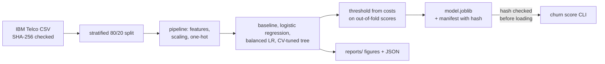
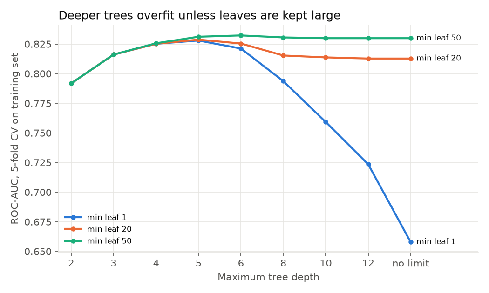
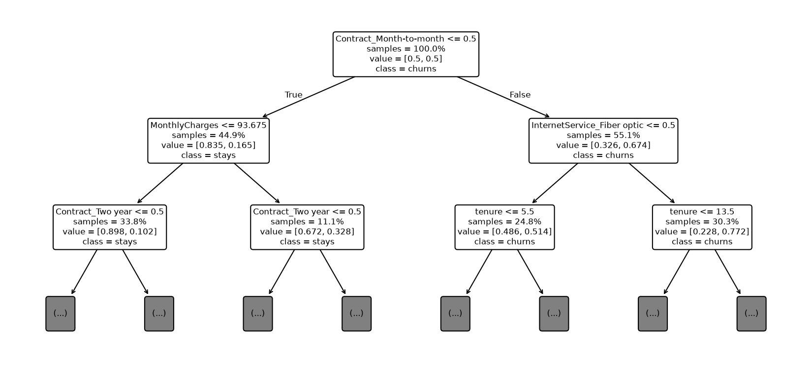
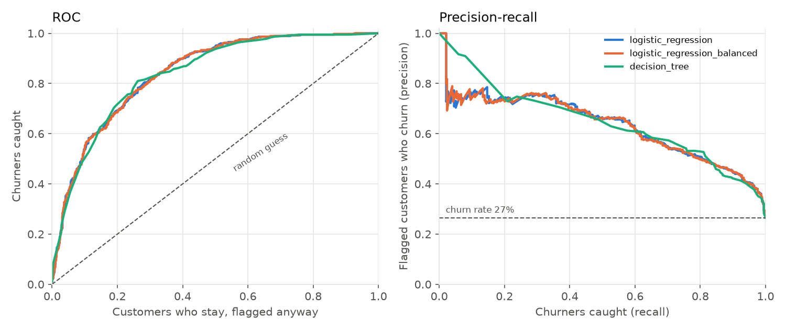
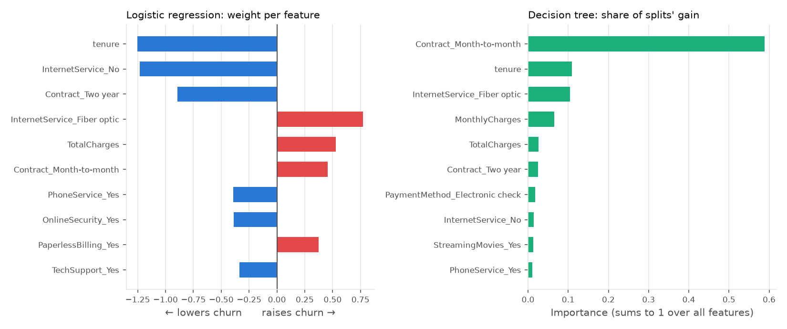
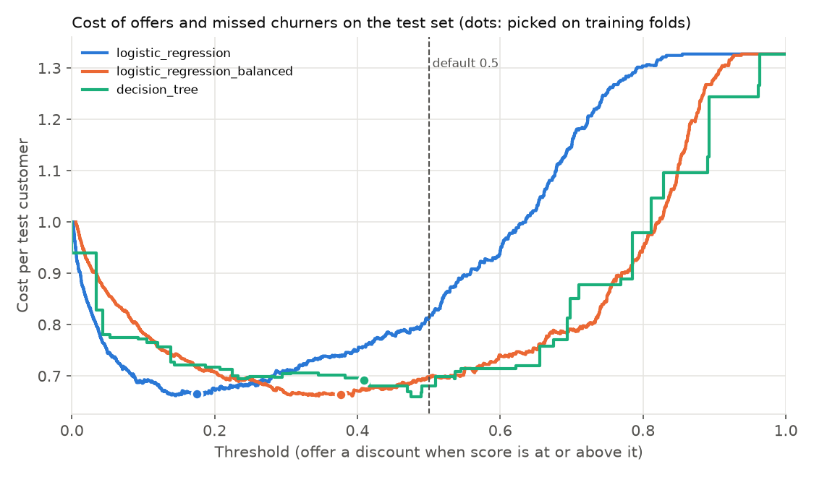

# Customer churn prediction

[](https://github.com/AnoushahWasif/customer-churn-prediction/actions/workflows/ci.yml)

Predicting which customers of a telecom company are likely to cancel, using the public IBM Telco Customer Churn dataset (7,043 customers, 21 columns, about 26% churned).

The goal isn't only a good score. It's a model a retention team could act on: the main metric weighs a missed churner as more costly than a wasted discount offer, and the decision threshold comes from that cost, not the default 0.5.

**Result:** with a discount offer costing 1 and a lost customer 5, logistic regression with a cost-picked threshold catches 335 of 374 test churners and cuts the cost from 1,147 (at the default 0.5) to 937, a third less than offering everyone a discount. The 31 churners it still misses look like loyal long-term customers, and nothing in this dataset hints that they'll leave.

## Quick start

Needs Python 3.12 and [uv](https://docs.astral.sh/uv/).

```bash
make install
make data                     # downloads the CSV, pinned to a commit and checked by SHA-256
uv run churn train            # fits the model, picks its threshold from costs, saves models/
uv run churn score customers.csv --out scores.csv
uv run churn reports          # rebuilds every figure and JSON in reports/
make test                     # 102 tests on generated customers, no download needed
```

## How it fits together



Design decisions and a short threat model are in [docs/ARCHITECTURE.md](docs/ARCHITECTURE.md).

## Early findings (EDA)


- **Contract is the biggest split:** 43% of month-to-month customers churn, against 3% on two-year contracts.
- **New customers leave most:** 53% churn in the first 6 months, 10% after 4 years.
- **Electronic check** payers churn at 45%; automatic payments 15–17%.
- **Fiber churns more than DSL in every contract type** (55% vs 32% on month-to-month), so it isn't just a contract effect.
- **Protective add-ons** (security, backup, device protection, tech support): 57% churn with none, 5% with all four.
- Gender and phone service make almost no difference.

Full notebook: [notebooks/02_eda.ipynb](notebooks/02_eda.ipynb).

## Results at the default threshold

Stratified 80/20 split, 1,409 test customers, 374 of them churned. This table uses the default 0.5 threshold; [Picking the threshold from costs](#picking-the-threshold-from-costs) below replaces it.

| Model | Churners caught | Missed | Wasted offers | Accuracy | ROC-AUC |
|-------|-----------------|--------|---------------|----------|---------|
| Predict "nobody churns" | 0% | 374 | 0 | 73.5% | 0.50 |
| Logistic regression | 55.6% | 166 | 109 | 80.5% | 0.842 |
| Logistic regression, class-balanced | 78.6% | 80 | 287 | 74.0% | 0.842 |
| Decision tree, depth 6, class-balanced | 78.1% | 82 | 257 | 75.9% | 0.838 |

The do-nothing baseline scores 73.5% accuracy, which is why accuracy isn't the metric here. Balancing the classes halves the missed churners at the cost of about 180 more discount offers. Whether that trade is worth it depends on what each mistake costs, which is the next section.

### Decision tree

Depth and minimum leaf size were picked by 5-fold cross-validation on the training set only (27 combinations, scored on ROC-AUC). Best: depth 6, at least 50 customers per leaf.



A tree allowed to split down to single customers scores 0.66 in cross-validation: it memorises the training rows. Keeping leaves at 50+ customers holds it at about 0.83 from depth 5 onwards, however deep the tree is allowed to grow.



The first splits are the same drivers the EDA found: contract type, then monthly charges or fiber internet, then tenure. The tree catches about as many churners as balanced logistic regression with 30 fewer wasted offers, but ranks customers slightly worse overall (ROC-AUC 0.838 vs 0.842). The `value` pairs in the plot are class-weighted, so they read as balanced proportions, not raw counts.

### Comparing the three models



- Plain and class-balanced logistic regression draw **the same curve**. Balancing moves where the 0.5 cut falls, not the order customers are ranked in, so it changes the confusion matrix but not ROC-AUC.
- The tree is close everywhere and slightly ahead only at the very top of the list (the few customers it's most sure about).

At the 0.5 threshold, out of 1,409 test customers:

| Model | Churners caught | Missed | Wasted offers | Stayed, left alone |
|-------|-----------------|--------|---------------|--------------------|
| Logistic regression | 208 | 166 | 109 | 926 |
| Logistic regression, balanced | 294 | 80 | 287 | 748 |
| Decision tree | 292 | 82 | 257 | 778 |

What each model leans on:



- Both agree on the big three: contract type, tenure and fiber internet.
- The tree puts 59% of its weight on "month-to-month" alone and never uses 8 of its 27 inputs (partner, one-year contract, three payment methods, among others).
- Logistic regression gives `TotalCharges` a *positive* weight, which reads as "paying more in total means more churn". That's misleading on its own: total charges is roughly tenure × monthly charge, and with tenure already in the model (−1.25) the two weights partly cancel. Correlated inputs make single coefficients hard to read; the tree's split on tenure is the plainer story.

## Picking the threshold from costs

**The assumption:** a retention offer (a discount) costs 1 unit, and losing a customer costs 5. Every offer is paid for, including the ones that go to customers who were going to leave anyway. These numbers aren't from a real company; they're stated so they can be changed (`churn.threshold.Costs`), and the table further down shows how the answer moves with them.

Each model's threshold is picked on out-of-fold scores from the training set (5 folds, every customer scored by a model that never saw them). The test set is only used to report what that choice costs.



Cost on the 1,409 test customers (lower is better):

| | Threshold | Churners caught | Wasted offers | Cost | Cost at 0.5 |
|---|---|---|---|---|---|
| Offer nobody | | 0 | 0 | 1,870 | |
| Offer everyone | | 374 | 1,035 | 1,409 | |
| Logistic regression | 0.175 | 335 | 407 | **937** | 1,147 |
| Logistic regression, balanced | 0.377 | 334 | 401 | **935** | 981 |
| Decision tree | 0.409 | 317 | 373 | 975 | 959 |

- **Once the threshold comes from costs, class balancing stops mattering.** Plain and balanced logistic regression end up making almost the same decisions (937 vs 935). Balancing only moved where 0.5 falls; the cost-picked threshold moves it back.
- **Plain logistic regression's threshold lands close to theory.** If scores were true probabilities, the best cut would be offer ÷ missed = 0.2 at these costs. It picked 0.175, and across cost ratios it stays near that line (2:1 → 0.56 vs 0.5, 3:1 → 0.33 vs 0.33, 10:1 → 0.14 vs 0.10, 20:1 → 0.05 vs 0.05). Balanced scores aren't probabilities, so its threshold can only be found by search.
- **The tree's picked threshold did slightly worse than 0.5 on the test set** (975 vs 959). A depth-6 tree gives only 46 distinct scores on the test set, so its cost moves in big steps and a threshold that was best on the training folds can sit on the wrong side of a step for new customers. The two logistic regressions have smooth curves and transfer well.
- Against simply offering everyone a discount, the best model saves about a third (1,409 → 935).

### The churners every model misses

At these thresholds, 31 of the 374 test churners are missed by all three models, 34 by some, and 309 are caught by all.

| | Missed by all (31) | Caught by all (309) |
|---|---|---|
| Month-to-month contract | 32% | 98% |
| Fiber internet | 29% | 73% |
| Pays by electronic check | 23% | 61% |
| Median tenure | 45 months | 5 months |
| Median monthly charge | 67.50 | 76.65 |

The missed churners look like loyal customers: on contracts, years in, paying less. Nothing in these 19 columns warns about them, so a different model won't fix it. Catching them would need other data, such as support calls, recent price changes or usage drops.

## The command-line tool

`churn train --offer-cost 1 --missed-cost 10` picks the threshold for different costs. The served model is plain logistic regression: it costs about the same as the balanced one (937 vs 935 on the test set) and its scores read as probabilities.

`customers.csv` needs the 19 input columns of the Telco file; `customerID` is optional. The output has one row per customer:

```
customer_id,churn_score,offer
7590-VHVEG,0.6131,yes
5575-GNVDE,0.0452,no
```

What `score` guards against:
- **A swapped or corrupted model file.** `model.joblib` is a pickle, and loading a pickle runs code, so its SHA-256 is checked against `model.json` (or `--sha256` from outside) before it's opened.
- **Bad input.** Missing columns, text or negative numbers, files over 50 MB or 200,000 rows. Each error names the column and line, and exits with code 2 without writing anything.
- **Spreadsheet formula injection.** A customer ID starting with `=`, `+`, `-` or `@` would run as a formula when the output is opened in Excel, so it gets a leading `'`.
- **Values never seen in training** (a new payment method, say). These are scored as "none of the known options" and the command says so.

CI runs ruff and the tests, trains and scores on the real data, checks that a tampered model is refused, audits dependencies with pip-audit, and scans the history with Gitleaks.

## Limitations

- **The costs are made up.** 1 for an offer and 5 for a lost customer are stated assumptions, not a real company's numbers. Change them with `--offer-cost` and `--missed-cost`; the threshold moves a lot (0.56 at 2:1, 0.05 at 20:1).
- **An offer is assumed to always work.** In reality some churners leave anyway, which makes offers worth less and pushes the threshold up.
- **One snapshot.** The data has no dates, so there's no check that a model trained on last year still works this year.
- **Small and old dataset.** 7,043 customers from IBM's sample data. Patterns like "electronic check churns more" may not carry over to a real company.
- **The tree's threshold doesn't transfer well** (46 distinct scores), which is one reason the served model is logistic regression.
- **Correlated inputs** make single logistic regression weights misleading (`TotalCharges` vs `tenure`).

## Project structure

```
src/churn/       data download, features, training, comparison, threshold, model store, CLI
tests/           102 pytest tests on generated customers (no download needed)
notebooks/       first look and EDA, dead ends included
reports/         JSON results and figures, rebuilt by `churn reports`
docs/            ARCHITECTURE.md with decisions and threat model
```

## Stack

Python 3.12, pandas, scikit-learn, matplotlib, pytest, ruff, uv. CI on GitHub Actions with pip-audit and Gitleaks.

## License

MIT
