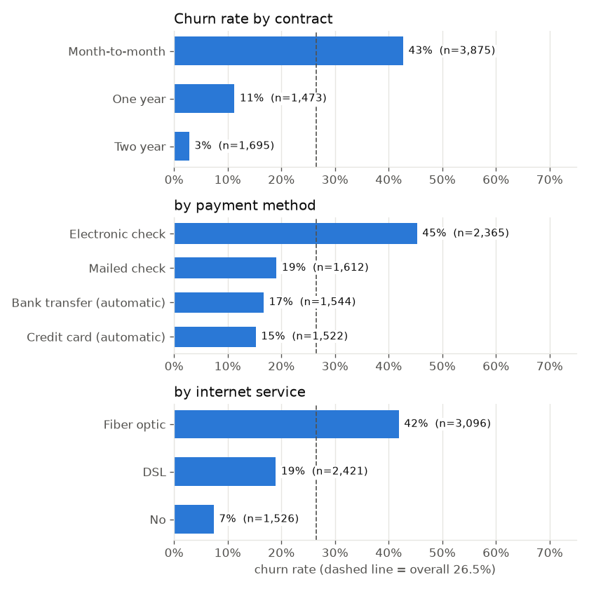

# Customer churn prediction

> Work in progress. Started October 2026.

Predicting which customers of a telecom company are likely to cancel, using the public IBM Telco Customer Churn dataset (7,043 customers, 21 columns, about 26% churned).

The goal isn't only a good score. It's a model a retention team could act on: the main metric weighs a missed churner as more costly than a wasted discount offer, and the decision threshold comes from that cost, not the default 0.5.

## Early findings (EDA)



- **Contract is the biggest split:** 43% of month-to-month customers churn, against 3% on two-year contracts.
- **New customers leave most:** 53% churn in the first 6 months, 10% after 4 years.
- **Electronic check** payers churn at 45%; automatic payments 15–17%.
- **Fiber churns more than DSL in every contract type** (55% vs 32% on month-to-month), so it isn't just a contract effect.
- **Protective add-ons** (security, backup, device protection, tech support): 57% churn with none, 5% with all four.
- Gender and phone service make almost no difference.

Full notebook: [notebooks/02_eda.ipynb](notebooks/02_eda.ipynb).

## Results so far

Stratified 80/20 split, 1,409 test customers, 374 of them churned. Threshold 0.5 for now (Day 8 picks it from costs).

| Model | Churners caught | Missed | Wasted offers | Accuracy | ROC-AUC |
|-------|-----------------|--------|---------------|----------|---------|
| Predict "nobody churns" | 0% | 374 | 0 | 73.5% | 0.50 |
| Logistic regression | 55.6% | 166 | 109 | 80.5% | 0.842 |
| Logistic regression, class-balanced | 78.6% | 80 | 287 | 74.0% | 0.842 |

The do-nothing baseline scores 73.5% accuracy, which is why accuracy isn't the metric here. Balancing the classes halves the missed churners at the cost of about 180 more discount offers. Whether that trade is worth it depends on what each mistake costs, which is Day 8.

## Plan

- [x] Download script and data dictionary
- [x] EDA: churn by contract type, tenure, charges, services
- [x] Preprocessing pipeline (`ColumnTransformer`) with tests
- [x] Baseline and logistic regression
- [ ] Decision tree with cross-validated depth
- [ ] Model comparison (ROC/PR curves, confusion matrices)
- [ ] Cost-based threshold, and a look at the customers each model gets wrong
- [ ] CLI and CI

## Stack

Python 3.12, pandas, scikit-learn, matplotlib, pytest, ruff, uv.

## Quick start

```bash
uv sync
make lint
make test
```

## Architecture

See [docs/ARCHITECTURE.md](docs/ARCHITECTURE.md).

## License

MIT
