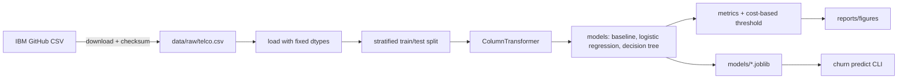

# Architecture

## Context

A small, offline ML project. It runs on one laptop and has no server, database or cloud parts. The input is one public CSV (IBM Telco Customer Churn). The outputs are a trained model file, evaluation figures, and a CLI that scores a CSV of customers.

## Components

| Component | Where | What it does |
|-----------|-------|--------------|
| Download | `src/churn/data.py` | Fetches the CSV into `data/raw/`, checks its SHA-256, loads it with fixed dtypes |
| Preprocessing | `src/churn/features.py` | `ColumnTransformer`: fixes `TotalCharges` blanks, scales numbers, one-hot encodes categories |
| Training | `src/churn/train.py` | Stratified split, fits the baseline, logistic regression and decision tree, saves to `models/` |
| Evaluation | `src/churn/metrics.py` | ROC-AUC, PR-AUC, recall, and cost per customer at a chosen threshold; writes figures to `reports/figures/` |
| CLI | `src/churn/cli.py` | `churn train` and `churn predict <csv>` |
| Notebooks | `notebooks/` | EDA and comparisons. They import from `src/churn` instead of copying code |

## Data flow

## Decisions

- **scikit-learn only.** The dataset is 7k rows, so gradient boosting or deep learning would add little here. Those come in later projects.
- **Preprocessing lives inside the pipeline.** The scaler and encoder are fitted on the training split only, so no test-set information leaks in, and the saved model takes raw columns.
- **Stratified split, fixed seed.** About 26% of customers churned, so stratifying keeps that ratio the same in train and test.
- **Cost-based threshold.** Missing a churner (lost revenue) is assumed to cost more than offering a discount to someone who would have stayed. The cost ratio is a stated assumption in the config, not a hidden number.
- **Data and models are not committed.** The download script and training run rebuild them.

## Threat model (STRIDE, short)

The risk here is small: there's no service, no users, and no secrets. The parts that matter:

| Threat | Where | Mitigation |
|--------|-------|------------|
| **Tampering:** the downloaded CSV is changed or replaced | Download | Pin the source URL to a commit and check the SHA-256 before loading |
| **Tampering / code execution:** loading a malicious `.joblib` (pickle runs code on load) | CLI `predict` | Only load models this project trained, from `models/`. Document this in the README |
| **Tampering:** a compromised dependency | Install | Locked versions in `uv.lock`; Dependabot and a dependency scan in CI |
| **Information disclosure:** customer data in the repo | Git | `data/` is git-ignored. The dataset is public and has no real personal data, but `customerID` is dropped before training anyway |
| Spoofing, repudiation, DoS, elevation of privilege | n/a | No network service or user accounts, so these don't apply |
