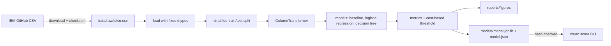

# Architecture

## Context

A small, offline ML project. It runs on one laptop and has no server, database or cloud parts. The input is one public CSV (IBM Telco Customer Churn). The outputs are a trained model file with a hash manifest, evaluation figures, and a CLI that scores a CSV of customers.

## Components

| Component | Where | What it does |
|-----------|-------|--------------|
| Download | `src/churn/data.py` | Fetches the CSV into `data/raw/`, checks its SHA-256, loads it with fixed dtypes |
| Preprocessing | `src/churn/features.py` | `ColumnTransformer`: fixes `TotalCharges` blanks, scales numbers, one-hot encodes categories |
| Training | `src/churn/train.py` | Stratified split, fits the baseline, two logistic regressions and a CV-tuned decision tree |
| Evaluation | `src/churn/metrics.py`, `compare.py` | ROC-AUC, PR-AUC, recall, confusion counts, coefficients and importances; figures in `reports/figures/` |
| Threshold | `src/churn/threshold.py` | Cost per customer at every threshold, picked on out-of-fold training scores; who gets missed |
| Model store | `src/churn/model_store.py` | Saves the model with a manifest (SHA-256, threshold, costs) and refuses to load a file whose hash doesn't match |
| CLI | `src/churn/cli.py` | `churn train`, `churn score <csv>`, `churn reports` |
| Notebooks | `notebooks/` | EDA and comparisons. They import from `src/churn` instead of copying code |

## Data flow

## Decisions

- **scikit-learn only.** The dataset is 7k rows, so gradient boosting or deep learning would add little here. Those come in later projects.
- **Preprocessing lives inside the pipeline.** The scaler and encoder are fitted on the training split only, so no test-set information leaks in, and the saved model takes raw columns.
- **Stratified split, fixed seed.** About 26% of customers churned, so stratifying keeps that ratio the same in train and test.
- **Cost-based threshold.** Missing a churner (lost revenue) is assumed to cost more than offering a discount to someone who would have stayed. The cost ratio is a stated assumption (`Costs` in `threshold.py`, `--offer-cost`/`--missed-cost` on the CLI), not a hidden number. The threshold is picked on out-of-fold training scores so the test set stays untouched.
- **Plain logistic regression is the served model.** It costs the same as the balanced one at its own threshold (937 vs 935), its scores are close to real probabilities, and its cost curve is smooth, unlike the tree's.
- **Data and models are not committed.** The download script and training run rebuild them.

## Threat model (STRIDE, short)

The risk here is small: there's no service, no users, and no secrets. The parts that matter:

| Threat | Where | Mitigation |
|--------|-------|------------|
| **Tampering:** the downloaded CSV is changed or replaced | Download | Pin the source URL to a commit and check the SHA-256 before loading |
| **Tampering / code execution:** loading a malicious `.joblib` (pickle runs code on load) | CLI `score` | The manifest stores the model's SHA-256, checked before unpickling; `--sha256` lets a deploy pin it from outside |
| **Tampering:** a compromised dependency | Install | Locked versions in `uv.lock`; Dependabot alerts and pip-audit in CI |
| **Information disclosure:** customer data in the repo | Git | `data/` is git-ignored. The dataset is public and has no real personal data, but `customerID` is dropped before training anyway |
| **Tampering:** a CSV that runs formulas when the scores are opened in Excel (CWE-1236) | CLI `score` output | Customer ids starting with `= + - @` get a leading `'` |
| **Denial of service:** a huge input file | CLI `score` | 50 MB and 200,000-row caps, checked before scoring |
| Spoofing, repudiation, elevation of privilege | n/a | No network service or user accounts, so these don't apply |
